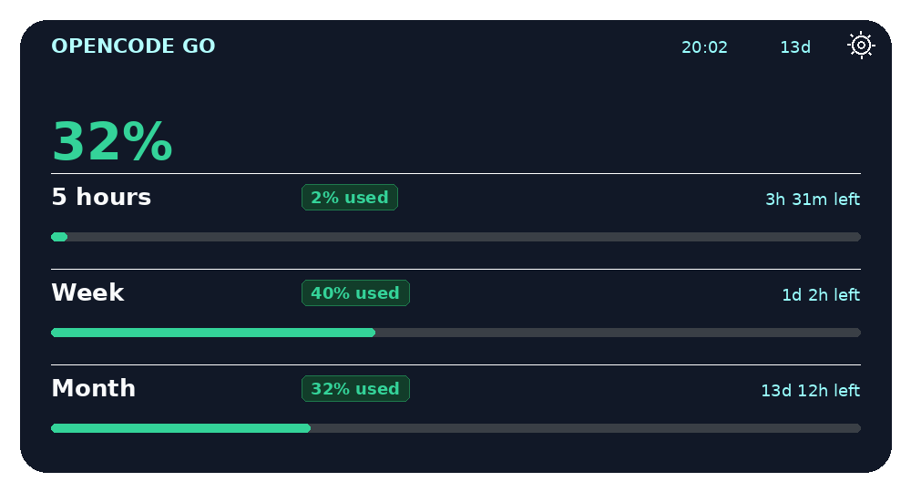
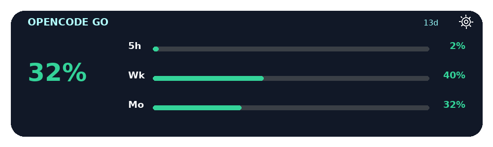

# Go Panel

An unofficial, dark-only Android home-screen widget for **OpenCode Go / Go Plus**. It shows the **used** allowance in the same style as the Go panel, in two sizes.

| 4x2 | 4x1 |
| --- | --- |
|  |  |

*Previews use demo data.*

## Features

- Used percentage for the **5-hour**, **weekly**, and **monthly** allowance, not the remaining amount.
- Large **monthly** used percentage on both widget sizes.
- 4x2 widget: 5-hour / week / month badges, reset countdowns, and progress bars.
- 4x1 compact widget: large monthly percentage and three mini rows.
- Bars and badges: green below 50%, yellow from 50% to 74%, red at 75% and above.
- Subscription end countdown in days, shown subtly in the widget header.
- Tap to refresh, a 10-minute inexact alarm while the device is awake, and a 30-minute WorkManager backstop with deduplication.
- Dark-only app.
- API key stored encrypted with the Android Keystore. No backend, no analytics.
- English and Turkish UI.

## Install

1. Download `app-release.apk` from the [Releases](../../releases) page, or build it yourself.
2. Install it on Android 8.0+ (API 26+). The APK is universal and works on ARMv7, ARM64, and x86.
3. Open **Go Panel** and paste your OpenCode Go API key.
4. Tap **Save and test**.
5. Add the **OpenCode Go** (4x2) or **OpenCode Go Compact** (4x1) widget to your home screen.

### Where to get an API key

Open <https://opencode.ai/console/go> and copy the Go API key (`oc_sk_...`). The app only calls:

```
GET https://opencode.ai/console/api/go/status
```

It does not need your password, session cookie, or organization ID.

### API key permissions — important

The console's current permission check is stricter than the app's needs:

- Keys with only **`usage:read`** or **read-only** permissions are currently rejected by the console.
- Use the **Go API key** from the Go page, or a personal key with **`all`**.
- The app itself only performs a read-only GET and never writes to your account.

This is a limitation of the console's current permission check, not of the app. See [docs/API_KEY.md](docs/API_KEY.md).

## Refresh behavior

- **Tap** the widget for an immediate refresh.
- **Automatic:** a 10-minute inexact `AlarmManager` alarm refreshes while the device is awake. It does not wake the device.
- **Backstop:** WorkManager runs a 30-minute background refresh in case the alarm is deferred.
- A short dedupe interval prevents duplicate API calls.
- Android may batch or delay background work in Doze/deep sleep; updates resume when the device wakes.
- There is no foreground service. WorkManager may hold a brief wake lock only while a worker is running.

## How it works

The app reads the `access.meters` object from the console response:

```json
{
  "fiveHour": { "limitMicroCents": "1200000000", "usedMicroCents": "12000000", "resetsAt": "..." },
  "week":     { "limitMicroCents": "3000000000", "usedMicroCents": "1200000000", "resetsAt": "..." },
  "month":    { "limitMicroCents": "6000000000", "usedMicroCents": "1920000000", "resetsAt": "..." }
}
```

Used percentage is calculated as `used / limit`. If the API reports usage above the limit, it is clamped to 100%. Bar and badge colors use these thresholds:

- 0–49%: green
- 50–74%: yellow
- 75%+: red

The small header countdown comes from the subscription period end (`access.endsAt`).

## Build

Requirements: JDK 21, Android SDK 35, and internet access for Gradle dependencies.

```bash
export JAVA_HOME=/path/to/jdk-21
export ANDROID_HOME=/path/to/android-sdk

# Optional; AGP can also use ANDROID_HOME
echo "sdk.dir=$ANDROID_HOME" > local.properties

./gradlew testDebugUnitTest
./gradlew assembleDebug
```

The debug APK is at `app/build/outputs/apk/debug/app-debug.apk`.

### Release build

`assembleRelease` produces a non-debuggable APK. If no `keystore.properties` exists, it uses the Android debug keystore so the APK can be sideloaded. For a proper release key:

```bash
keytool -genkeypair -v -keystore keystore.jks -alias go-panel \
  -keyalg RSA -keysize 2048 -validity 10000

cp keystore.properties.example keystore.properties
# edit keystore.properties with your passwords

./gradlew assembleRelease
```

The APK is at `app/build/outputs/apk/release/app-release.apk`.

`keystore.properties` and `*.jks` are gitignored. Never commit them. If you previously installed a build signed with a different key, uninstall it before installing the new release.

For public GitHub releases, set these repository secrets:

- `KEYSTORE_BASE64` — base64 of your keystore (`base64 -w0 keystore.jks`)
- `KEYSTORE_PASSWORD`
- `KEY_ALIAS`
- `KEY_PASSWORD`

The release workflow uses them to sign the APK. Without them, the workflow fails instead of publishing a debug-signed APK.

## Security and privacy

- App permissions: `INTERNET`, `ACCESS_NETWORK_STATE`, and `RECEIVE_BOOT_COMPLETED`. WorkManager adds `WAKE_LOCK` for the brief duration of a worker; the app does not start a foreground service.
- No storage, location, contacts, camera, microphone, or notification permission.
- The API key is stored in `EncryptedSharedPreferences`, backed by the Android Keystore.
- `android:allowBackup="false"` and data extraction rules prevent key backups.
- The widget never displays the key.
- HTTPS only; cleartext traffic and redirects are disabled.
- The app has no analytics, crash reporting, WebView, or third-party network calls.
- The API key is only sent to `opencode.ai`.

See [PRIVACY.md](PRIVACY.md) and [SECURITY.md](SECURITY.md).

## Disclaimer

This is an unofficial project. It is not affiliated with, endorsed by, or supported by OpenCode. The console endpoint used here is internal and may change without notice. Use it at your own risk.

## License

MIT. See [LICENSE](LICENSE).

---

## Türkçe

OpenCode Go / Go Plus kullanımını **kullanılan** yüzde olarak gösteren, yalnızca koyu temalı, resmî olmayan bir Android widget'ı. Go panelindeki gibi kullanılan yüzdeleri gösterir.

### Kurulum

1. [Releases](../../releases) sayfasından `app-release.apk` dosyasını indir.
2. Android 8.0+ (API 26+) bir cihaza kur.
3. **Go Panel** uygulamasını aç, OpenCode Go API anahtarını (`oc_sk_...`) yapıştır.
4. **Kaydet ve test et** düğmesine bas.
5. Ana ekrana **OpenCode Go** (4x2) veya **OpenCode Go Kompakt** (4x1) widget'ını ekle.

### API anahtarı ve izinler — önemli

Console'un mevcut izin kontrolü uygulamanın ihtiyacından daha katı:

- Sadece **`usage:read`** veya **salt-okunur** izinli anahtarlar şu an reddediliyor.
- **Go API anahtarını** veya **`all`** izinli bir anahtar kullan.
- Uygulama yalnızca salt-okunur `GET` yapar; hesabına yazmaz.

Bu, uygulamanın değil Console'un mevcut izin kontrolünün bir sınırlamasıdır. Ayrıntılar: [docs/API_KEY.md](docs/API_KEY.md).

### Yenileme

- Widget'a dokun: hemen yenilenir.
- Uyanıkken 10 dakikalık inexact alarm ile otomatik yenilenir; cihazı uyandırmaz.
- Arka planda WorkManager 30 dakikalık yedek yenileme yapar.
- Çift istekleri engelleyen dedupe var.
- Android pil tasarrufu için arka plan işlerini geciktirebilir; cihaz uyandığında güncellenir.
- Foreground servis yoktur; WorkManager yalnızca worker çalışırken kısa süreli wake lock kullanabilir.

### Widget renkleri

- %0–49: yeşil
- %50–74: sarı
- %75+: kırmızı

### Güvenlik

- Uygulama izinleri: `INTERNET`, `ACCESS_NETWORK_STATE`, `RECEIVE_BOOT_COMPLETED`. WorkManager, worker çalışırken kısa süreli `WAKE_LOCK` kullanır; foreground servis yoktur.
- Depolama, konum, kişiler, kamera, mikrofon veya bildirim izni yoktur.
- API anahtarı Android Keystore destekli `EncryptedSharedPreferences` içinde şifreli saklanır.
- Yedekleme kapalıdır (`allowBackup=false`).
- Widget anahtarı hiçbir zaman göstermez.
- Yalnızca HTTPS; cleartext trafik ve yönlendirmeler kapalıdır.
- Analitik, reklam, WebView veya üçüncü taraf ağ isteği yoktur.
- Anahtar yalnızca `opencode.ai` adresine gönderilir.

### Yasal uyarı

Bu proje resmî değildir; OpenCode ile bağlantılı değildir. Kullanılan console uç noktası dahili bir uç noktadır ve haber verilmeden değişebilir. Sorumluluk kullanıcıdadır.
